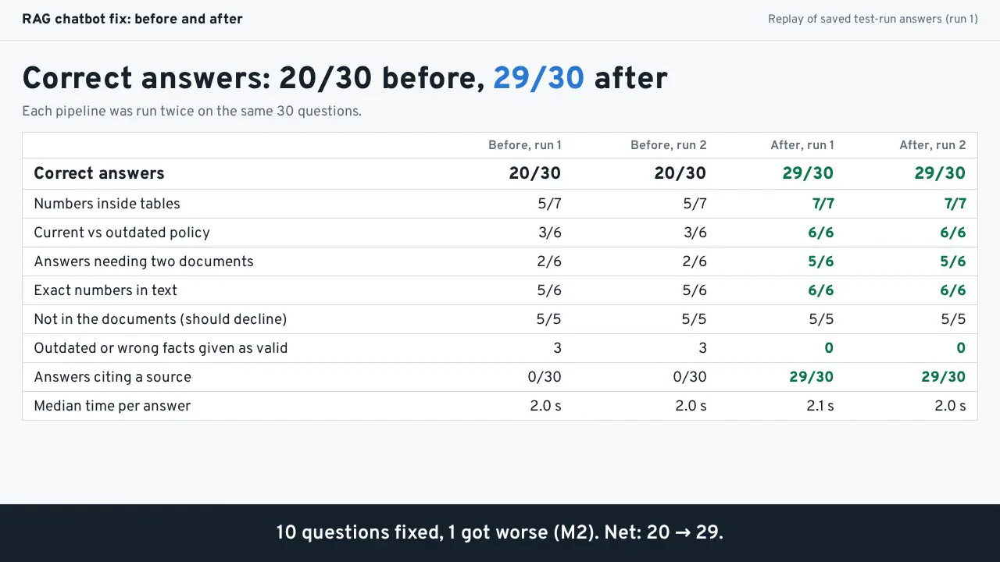

# RAG chatbot fix: before and after (case study)

Case study on synthetic documents: a support chatbot went from **20/30 to 29/30** correct answers on the same documents, questions and LLM. Outdated facts given as valid: 3 to 0. 29 answers now cite their source.

Case study page with the 56-second video: https://slimanechanchoul.com/rag-fix/

Demo on synthetic data: the company (Orbitask) and its 12 documents are made up for this case study.



## The problem

A support chatbot over 12 synthetic company documents answered 20 of 30 test questions correctly. It gave an outdated refund rule as valid, lost rows when a table was cut in half, missed the right document, and cited no source. The documents, the questions and the LLM stayed the same. Only the pipeline changed: chunking, retrieval, document dates and the prompt.

## The test set

- `kb/` 12 synthetic documents (fictional company Orbitask), with the usual traps: tables, an outdated 2024 refund policy next to the current one, similar wording, facts split across documents.
- `eval/questions.json` 30 questions with gold answers and sources: numbers inside tables (7), current vs outdated policy (6), answers needing two documents (6), exact numbers (6), and 5 questions the documents do not answer. Saved in git before the first run.
- `eval/dev_questions.json` 8 separate questions used while building.
- `eval/rubric.md` the grading rubric.

## Before and after

Each pipeline was run twice; both runs gave the same scores.

| | Before (run 1 / run 2) | After (run 1 / run 2) |
|---|---|---|
| Correct answers | 20 / 20 of 30 | 29 / 29 of 30 |
| Outdated or wrong facts given as valid | 3 / 3 | 0 / 0 |
| Answers citing a source | 0 / 0 | 29 / 29 |
| Median time per answer | 2.03 s / 1.96 s | 2.12 s / 2.04 s |

Question by question: 10 questions wrong in both before runs became right in both after runs; 1 question (M2) right in both before runs became a miss in both after runs. 20 + 10 - 1 = 29. Full results, the three worked examples and the M2 story: [`outputs/report.md`](outputs/report.md).

### What changed

| | Before (typical first build) | After |
|---|---|---|
| Chunking | fixed 500 characters, 50 overlap, cuts tables | one chunk per heading section, tables never split |
| Retrieval | embeddings only, top 2 | BM25 + embeddings (reciprocal rank fusion), cross-encoder rerank, top 6 |
| Metadata | none | effective date + current/superseded status; outdated docs rank last |
| Prompt | "Answer the question based on the context below." | cite every fact, say "The documents don't say." when unsupported |

Both use google/gemini-3.8-flash (reasoning low) through OpenRouter and all-MiniLM-L6-v2 on CPU.

## Which fix mattered (ablation)

Each row changes ONE thing (`ablation.py`, committed before these runs; `rag.py` unchanged). Two runs each, same grader.

| Version | Correct of 30 (run 1 / run 2) | Outdated or wrong facts given as valid | Answers citing a source |
|---|---|---|---|
| Old bot | 20 / 20 | 3 / 3 | 0 / 0 |
| Old bot, 6 chunks instead of 2 | 25 / 25 | 2 / 2 | 0 / 0 |
| Fixed bot | 29 / 29 | 0 / 0 | 29 / 29 |
| Fixed bot, old 500-character chunks | 27 / 27 | 0 / 0 | 28 / 28 |
| Fixed bot, no dates or status | 29 / 27 | 0 / 2 | 29 / 28 |
| Fixed bot, no reranker | 28 / 28 | 0 / 0 | 29 / 30 |
| Fixed bot, old prompt | 30 / 30 | 0 / 0 | 0 / 0 |

More context alone explains part of the gain (20 to 25), but that version still gave the outdated refund rule as valid. Whole tables, dates/status and the reranker each matter. The strict prompt did not add accuracy on this set (the old prompt on the same chunks scored 30/30); it adds a cited source to every answer, and it is what cost M2. The fixed pipeline was not changed after these runs.

## How the numbers were measured

- The 30 eval questions and both pipelines were committed to git before the first eval run, and `ablation.py` before the one-change runs. Those commits are in the original working repository; this public repository is a clean copy published in one commit.
- Grading: exact checks on key numbers and phrases first, then an LLM judge with the written rubric (and the whole knowledge base) for the mixed cases.
- A second AI review, separate from the grader, checked 21 graded answers one by one against the documents: the grade (right or wrong) held for 21 of 21. For the one-change versions it checked 30 more: 30 of 30 held.
- Each of the 12 synthetic documents carries an effective date and status (current or superseded) in its header, written when the documents were made. The old pipeline does not use them. On real documents this comes from file dates, version names, or a one-time review in the first step.
- The whole case study, including the 4 main test runs, the 10 one-change runs and grading, cost $0.76 in LLM calls (OpenRouter usage data).

## How to run

You need Python 3 and an OpenRouter API key. The key is read only from the `OPENROUTER_API_KEY` environment variable; there is no default key in the code.

```
python3 -m venv .venv
.venv/bin/pip install torch --index-url https://download.pytorch.org/whl/cpu
.venv/bin/pip install sentence-transformers rank_bm25 requests numpy
export OPENROUTER_API_KEY=your-key-here
```

The first run downloads all-MiniLM-L6-v2 and the ms-marco cross-encoder from Hugging Face.

## Reproduce both runs

```
.venv/bin/python run_eval.py before 1
.venv/bin/python run_eval.py before 2
.venv/bin/python run_eval.py after 1
.venv/bin/python run_eval.py after 2
```

Each command answers the 30 questions, saves the raw answers to `outputs/runs/` and the grades to `outputs/graded/`. Add `dev` as a third argument to use the 8 dev questions instead.

Ablation, each variant twice:

```
for v in abl-before-top6 abl-after-fixed-chunks abl-after-no-metadata abl-after-no-rerank abl-after-old-prompt; do
  .venv/bin/python ablation.py $v 1 && .venv/bin/python ablation.py $v 2
done
```

`report.py` is the script that wrote `outputs/report.md`. Besides the graded runs it reads the spend log, the first grading pass and the second-review files, which are not part of this repository, so after your own runs compare the files in `outputs/graded/` with the tables above. The LLM can vary between runs; here both runs of each version gave the same main scores.

## Files

- `rag.py` both pipelines; `ablation.py` the one-change versions; `llm.py` OpenRouter client with cost logging (no prompts, no key); `grade.py` rules + LLM judge; `run_eval.py`; `report.py`.
- `kb/`, `eval/` the synthetic test set; `outputs/report.md` the full report.

## Licence

MIT, see [LICENSE](LICENSE).

For your own RAG or chatbot: a fixed test set built from your real questions, a before score, the repaired pipeline, an after score, and a report of what changed. I build these tools. https://www.upwork.com/freelancers/~01d6ae0f1a06a43ac0
